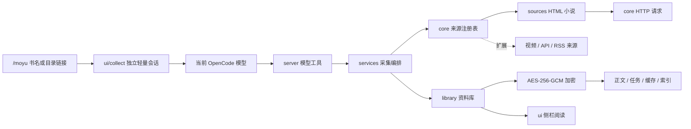
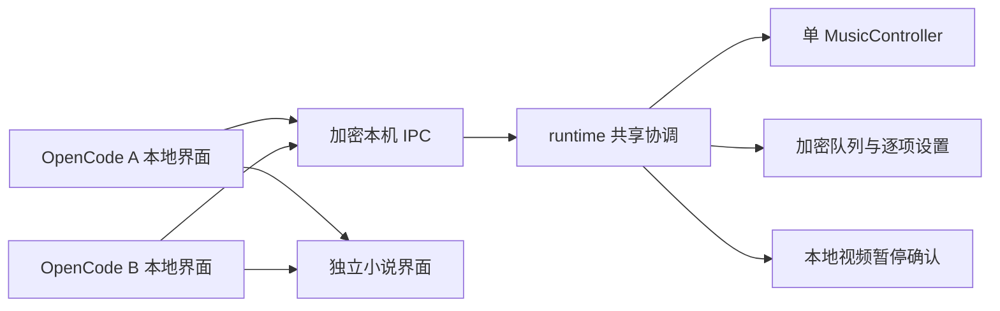

# 框架与接入约定

当前版本实现本地小说、HTML 小说采集、加密资料库、本地及 B 站 / YouTube 侧栏视频，以及三平台聚合音乐、歌单和 QQ 私人电台。视频支持原生图片协议和字符回退；多个 OpenCode 通过资料库共享运行层协调播放与设置。



## 目录职责

共享运行层由系统本机管道 / Socket 的排他监听选出一个宿主，所有窗口通过认证加密的有界消息调用同一音乐引擎。队列和设置只在变化时同步，播放进度使用轻量更新。视频通过请求、暂停确认和资格版本切换，迟到的释放不能清除新资格；暂停和取消可越过耗时下载。宿主关闭先停止媒体，再允许其他窗口接管，接管后保持暂停。



| 目录 | 职责 |
| --- | --- |
| `src/domain/contracts.ts` | 内容类型、来源能力、目录项、统一资源和附件契约 |
| `src/core/registry.mjs` | 注册来源、按 URL 或 ID 选择适配器 |
| `src/core/http.mjs` | 超时、大小限制、压缩和编码处理、代理、重定向检查、DNS 地址校验 |
| `src/sources/` | 网站 / API 的解析与来源适配；不引用 OpenCode 或 UI |
| `src/services/ingestion.mjs` | 目录读取、分批采集、限速、任务状态、续采与去重 |
| `src/library/store.mjs` | 资源索引、章节分片、锁、原子写入、入库与删除 |
| `src/library/vault.mjs` | 随机密钥、随机 nonce、AES-GCM 认证加密 |
| `src/library/text-reader.mjs` | TXT 解码、中文分页、章节识别、加密书籍读取 |
| `src/runtime/channel.mjs` | 按资料库真实路径和密钥确定本机管道 / Socket，认证加密及有界消息帧 |
| `src/runtime/media-server.mjs` | 单音乐引擎、视频优先及播放资格、全局设置逐项更新、账号版本 |
| `src/runtime/media-client.mjs` | 跨窗口命令、状态订阅、取消、断线重连、视频资格版本与设置写入收尾 |
| `src/server/index.ts` | 将服务层封装为当前模型可调用的 OpenCode 工具 |
| `src/server/v2.ts` | 2.x 工具注册、参数 schema、进度、权限及模型上下文 hook 适配 |
| `src/server/collection-context.mjs` | 注入后台采集规则、精简旧搜索结果、压缩请求移除工具定义 |
| `src/server/search-summary.mjs` | HTTP 搜索结果限量与正文剥离，避免搜索全文进入模型上下文 |
| `src/ui/index.tsx` | 原生侧栏、书架、阅读进度、删除确认和快捷键 |
| `src/ui/video.tsx` | 视频库、搜索 / 热门、画质切换、独立进度及静音生命周期 |
| `src/sources/local-video.mjs` | 本地视频探测与统一资源索引，保留原文件 |
| `src/sources/video-platforms.mjs` | B 站 / YouTube 链接规范化、精简搜索、B 站热门和视频信息 |
| `src/services/video-ingestion.mjs` | 下载器编排、取消、配额、去重、元数据及加密入库 |
| `src/media/settings.mjs` | 本地加密 YouTube API Key，不向模型公开 |
| `src/media/cache.mjs` | 流式媒体加密、认证解密、播放临时文件与陈旧文件清理 |
| `src/media/runtime.mjs` | FFmpeg / ffprobe / ffplay 查找、媒体探测及 WSL 路径适配 |
| `src/media/player.mjs` | 解码进程、暂停 / 跳转 / 静音、背压和生命周期取消 |
| `src/media/frame-queue.mjs` | 不可变输入块队列，跨块帧只组装一次，及时释放已消费引用 |
| `src/media/pixels.mjs` | 有界尺寸、保持比例、半格像素与颜色游程 |
| `src/media/inline-image.mjs` | 宿主图片能力检测、帧尺寸上限和 NativeImage 引用管理 |
| `src/music/providers.mjs` | 三平台音乐搜索、普通授权地址解析和网易云 / 酷狗扫码协议 |
| `src/music/playlists.mjs` | 三平台歌单 / 收藏查询、QQ我喜欢与个性推荐、有界歌曲分页和官方链接解析 |
| `src/music/qq-login.mjs` | QQ二维码、状态回调解析、受限 QQ OAuth 及 QQ音乐凭据交换 |
| `src/music/service.mjs` | 聚合查询、账号写入排队和有界音频临时下载 |
| `src/music/settings.mjs` | 独立加密账号、队列、音量及循环设置，公开账号状态不含凭据 |
| `src/music/player.mjs` | 音频时钟、FFplay 进程、切歌取消、播放队列及独立私人电台会话 |
| `src/music/login.mjs` / `temp.mjs` | 本地二维码页面、默认浏览器入口和临时文件生命周期 |
| `src/ui/music.tsx` | 聚合播放器、歌曲 / 歌单选择、批量入队和账号菜单 |
| `src/ui/collect.mjs` | 解析 /moyu 参数，复用宿主当前模型，将采集任务提交到会话队列 |
| `src/ui/sidebar-layout.mjs` | 2.x 侧栏宽度适配、会话最小宽度及隐藏 / 卸载时恢复宿主布局 |
| `src/ui/v2.ts` | 2.x 插槽、存储、键盘、主题和对话框 API 适配 |
| `scripts/` | 构建、独立安装器、打包、真实终端验证 |

依赖方向为入口 → 服务 → 来源 / 存储 → 基础设施。来源适配器不写文件；存储不解析网页；模型工具和 UI 不包含网站选择器逻辑。

## 新增来源

1. 在 `src/sources/` 新建模块，实现 `SourceAdapter`。声明 `id`、`kinds` 和 `capabilities`。
2. `catalog(url, context)` 返回统一目录；`fetch(item, context)` 返回获取结果。请求使用注入的 `context.page`，继承超时、大小限制和取消能力。
3. 在 `src/sources/index.mjs` 注册，专用网站适配器放在通用 HTML 适配器之前。
4. 用固定 HTML / API 响应测试解析，并通过注入 transport 测试失败与续采。不要在模型工具中按域名增加分支。

```js
registry.register({
  id: "my-site", name: "自定义来源",
  kinds: ["novel"], capabilities: ["catalog", "fetch"],
  matches: url => new URL(url).hostname === "example.com",
  async catalog(url, ctx) { /* 返回 SourceCatalog */ },
  async fetch(item, ctx) { /* 返回 text、title、mime */ },
})
```

通用来源只覆盖可直接请求的 HTML，支持明确的同站“下一页”目录链接，最多 50 页、20000 章，循环、上限及分页失败会返回 catalogComplete=false。默认每批补采 5 章，最大 50 章，章节与目录分页间隔 800 ms。单页最大 2 MiB、请求总时限 15 秒、最多跟随 4 次重定向；正文及章节清单总量上限 32 MiB。支持环境变量 `HTTP_PROXY`、`HTTPS_PROXY` 和主机名形式的 `NO_PROXY`。直接连接固定已校验的 DNS 地址；代理连接由受信任代理完成目标连接。复杂目录翻页、章节内翻页、认证及站点特殊规则需专用适配器。

`services/novel-snapshot.mjs` 负责目录合并、正文快照和进度摘要。目录读取即保存加密 job、resource 和包含全量章节占位的 moyubook；模型摘要分页与本地目录大小无关。正文按章节 URL 的哈希存储，刷新时按 URL 复用缓存，兼容旧版数字序号文件；历史中已知但当前目录移除的章节保留在末尾。404/410 记录为缺章，其余错误停止批次。明确章节清单包含稳定 ID、偏移及 ready/pending/failed 状态，阅读器优先使用它，旧书仍可从标题识别目录。书签同时保存章节 ID 与章内偏移，补采或重排时恢复相同章节，避免前文增长导致跳读。

## 接入视频等类型

统一 `ContentResource` 使用 `kind` 与 `assets`，附件通过 `role` 区分正文、媒体、字幕、封面和数据，`mime` 指定格式，`path` / `url` 指定位置。`metadata` 保存来源特有信息。存储层允许这些类型的资源索引；当前文字采集服务会明确拒绝非小说目录，避免把媒体误作 TXT。

接入新类型时依次增加：来源适配器 → 对应采集服务 / 媒体存储策略 → 对应展示器。视频需要独立的流式下载、缓存配额、清晰度 / 分段策略和播放器；不要通过解除文字页面大小限制来下载视频。今后若提供在线播放，媒体 URL、字幕和封面仍通过统一附件契约传递。

本地视频使用 `kind: video`、`source.adapter: local-video` 和 `assets.role: media`；`resolveLocalVideo` 返回播放器所需的路径、时长、显示比例和音轨信息。平台来源使用 `bilibili` / `youtube`，媒体附件 MIME 为 `application/x-moyu-video`，存储路径由资源 ID 派生。播放器仍只读经探测的本地文件，不把网页 URL 交给 FFmpeg；探测和解码协议仅允许 file / pipe。

平台数据适配器与媒体下载分开：B 站使用公开 JSON 接口；YouTube 使用 Data API v3，结果最多 5 项并限制文本长度。私密请求头不跨来源重定向，API 请求禁止重定向，YouTube 错误不回显原始错误体或密钥。API Key 独立写入加密设置，不进入 `moyu_library` 或模型输入；普通工具权限沿用宿主 `webfetch`。

媒体下载通过参数数组调用 yt-dlp，禁用用户配置、外部插件和远程组件自动下载，不传用户 Cookie 或登录信息。仅接受规范化 B 站 / YouTube 单视频 URL，默认按短边优先 1080p，支持 720p / 480p，缺少低清时选择最小可用清晰度，同等清晰度优先 H.264，兼容无音轨视频；限制 60 分钟、256 MiB；临时文件合计超过 512 MiB 或总耗时超过 10 分钟停止，取消时结束下载进程组。下载设置独立加密保存到 `.moyu/settings/video.enc`，UI 和模型工具共用。下载器错误仅保留精简原因，登录 / 人机验证提示转为明确停止消息，不向模型转发浏览器 Cookie 建议。按 URL 加锁覆盖下载、加密和索引写入；资源 ID 包含目标清晰度，满足目标的既有缓存可跨档位复用，提高目标时写独立副本，失败不删除旧版本。

`MediaCache` 使用独立 `MOYUVID1` 文件格式：8 字节魔数、12 字节 nonce、16 字节认证标签及流式密文，密钥沿用资料库 AES-256-GCM。解密输出仅在认证完成且媒体探测成功后交给播放器；失败立即清理。播放临时目录以进程 ID 和随机 ID 命名，权限 0700，文件权限 0600；切模式、隐藏、删除及释放插件时清理，下一次启动清理已退出进程的残留。资源索引删除通知会停止当前视频并清空画面及临时明文，外部本地原文件保留。

`PixelPlayer` 与宿主 UI 无关，FFmpeg 流式输出 RGB24，按 10 帧 / 秒消费，队列通过 stdout 背压限制；UI 注入帧尺寸计算器。像素风最多 160 × 100 像素，`pixelRuns` 将上下两个像素合并为一个半格字符，颜色量化到 216 色。原画根据侧栏实际像素尺寸以 Lanczos 缩放，解码单边最多 1920、总量最多 2073600 像素，支持原生图片协议下的 Full HD，不超过源分辨率；终端字符回退仍以列数 × 4、行数 × 8 限制解码尺寸。原视频保持宽高比，终端尺寸或画质变化后从当前进度重新解码，不把转码帧写入磁盘。

视频宽高与小说偏好分开保存，默认 60% 宽、100% 可用高度；大画面模式使用 75% 目标宽度及完整侧栏高度，主会话至少保留 44 列，临时收起原生卡片以保证画面与底部控件完整显示。兼容卡片位于滚动区内或滚动区之后的宿主布局，保留侧栏标题，恢复时只还原本插件收起的可见卡片，不显示原本隐藏的节点。还原模式恢复视频自己的宽高，切回小说恢复原阅读偏好。

`ui/video-size.mjs` 使用同一个缩放因子调整视频宽高，范围 25–200%，同时受 75% 侧栏宽度和 100% 可用高度限制。普通与大画面分别保存比例；单独调整宽高时先把当前缩放后的尺寸固化为新基准，避免另一边突然跳回旧值。自动尺寸在第一次比例调整时转为实际基准，尺寸计算保留精度，仅标签按一位小数显示。最小字符格、正文行数和主会话空间仍由原布局保护。

`domain/collection-task.mjs` 统一识别 `/moyu` 的小说 / 视频任务；`collection-context` 按任务注入对应后台规则。视频任务使用 `moyu_video_popular`、`moyu_video_search`、`moyu_video_info`、`moyu_video_import`，不进入小说章节采集。热门工具按页返回最多 10 条和 `hasMore`，只浏览 / 搜索时不自动下载，明确选定后逐个导入；权限、取消、来源拒绝和压缩规则沿用宿主适配。

`InlineImage` 使用宿主 `ImageRenderable` 与 `NativeImage.fromRgba`，交给宿主处理布局、裁剪、图层和图片协议，不直接写终端转义序列。图片资源归属当前 renderer 的 native scene；逐帧设置 source 后释放临时引用，替换、隐藏、删除和卸载时释放旧引用。宿主上报 Sixel / Kitty 可用时 UI 显示「原画」；有图片组件但只支持字符输出时显示「细腻字符」；缺少图片组件的旧宿主使用原来的像素风。图片加载异常回退像素风并报告，不能把字符回退标成原画。

B 站热门使用独立 HTTP 接口，每页最多 10 项，返回有界标题、作者、时长和规范化链接；不使用 API Key。搜索与热门可取消，切换面板取消未完成请求，通过请求身份检查避免旧响应打开菜单；点击结果仍走原有下载和加密服务。

尺寸和画质由同一个 80 ms 定时器合并处理，首次加载直接使用实际视口；实际输出像素尺寸与缩放方式不变时不启动新解码进程。切走会取消在途解密和媒体探测，清理完成前旧请求不能覆盖新选择。恢复视频按 ID 读取一条加密索引，不遍历整个书库。帧队列不对积累数据逐块 `Buffer.concat`，播放调度不在阻塞后以毫秒间隔追赶旧帧；像素模式使用稳定节点，时间控件只在显示秒数或状态变化时更新。

播放器默认暂停且静音。显式开声后用 `ffplay -nodisp` 播放音轨；暂停、切模式、隐藏、跳转、调整尺寸和释放插件时终止旧进程，异步回调通过代次校验防止旧任务复活。音频失败恢复静音并报错，20 秒无帧停止解码。音画由两个进程输出，非严格同步播放器。视频元数据通过原 `LibraryVault` 加密，进度按资源 ID 单独保存；本地原文件不加密也不删除，平台缓存采用上述流式加密。

## 任务、加密与删除

资源 ID 由来源适配器 ID 和规范化 URL 确定，任务记录持久化目录及成功章节下标。每章成功后先写加密分片，再记录完成位置。后续调用自动从未完成章节续接。任务失败保存错误并停止，不进行无限重试。进程间文件锁避免同一本书同时采集；已退出进程留下的锁可在重试时回收。

资料目录 `books/` 内的 `.moyubook`、`.moyu/jobs/*.enc`、`.moyu/parts/**/*.enc` 和 `.moyu/resources/*.enc` 均加密。`keys/library.key` 放在书架之外，权限 `0600`，不进入源码仓库或安装包。附带的原创示例 TXT 不属于敏感资料。

本地 TXT 导入为加密副本，外部源文件保留。删除资源会同时删除加密正文、索引、任务记录和章节分片，使用同一任务锁避免边采集边删除。删除是逻辑删除；默认密钥文件由本机账号持有，不提供密码解锁或操作系统管理员隔离。OpenCode KV 仅存储阅读位置、显示状态及哈希文件路径。

## 验证边界

`npm run build` 生成两代侧栏、两代服务端入口和独立安装器共五个文件；`npm run typecheck` 检查入口与契约；`npm test` 验证编码、分页、配置保留、免依赖安装、加密认证、目录过滤、分批续采、删除和来源扩展。

`python3 scripts/smoke.py` 使用临时 XDG 配置和数据库、独立 tmux 会话启动真实 OpenCode，检查工具 ID、侧栏、导入、加密、翻页、目录、隐藏、重启续读、窗口缩放和删除确认；不会发送模型请求。模型工具已注册与真实外部模型完成一轮自主采集，是两个不同的验证范围。

阅读区宽高偏好使用插件存储；正文按实际渲染宽度及侧栏滚动视口的可用高度重新分页，比例设置保留阅读偏移。2.x 宿主当前把侧栏及外层容器固定为 42 列，宽度适配器只调整已识别的侧栏容器，并为主会话保留至少 44 列；隐藏或卸载时恢复原尺寸。此适配依赖已验证的 2.1.2 / 2.1.3 容器结构，宿主升级后需要终端回归。1.x 不修改宿主宽度。

小说分页只保留当前书、当前宽度的换行结果和当前高度的页面列表；同宽度调高度只重新分组。字素宽度计算在一次换行中缓存最多 4096 项，继续使用 Unicode 字素分段，不拆开组合字符或 emoji。视频和隐藏状态暂停小说排版，恢复阅读时按最新尺寸计算，避免后台整本重排阻塞交互。`node scripts/benchmark.mjs` 可复现当前开销，`MOYU_BENCHMARK_BASELINE` 可指定旧版完整 checkout 比较并核对输出一致。

可点击操作统一在 `onMouseUp` 消费完整点击后打开弹窗；按钮关闭文本选择，并忽略拖动结束，防止一次点击的释放事件关闭新弹窗。正文仍支持文本选择。书架、章节、宽高、翻页、隐藏与恢复都有可见鼠标入口。

2.x 的 `sidebarDock` 给原侧栏内容容器设置视口最小高度，阅读区下方使用自动边距，使宿主 Context / 任务卡片保持底部位置。按原生卡片实际高度为正文预留空间，保留宿主原有渲染、更新和操作；隐藏阅读或卸载时恢复容器尺寸与原有布局回调。删除按钮位于顶部操作行，异步删除完成时只清空仍在阅读的同一资源，避免影响用户随后打开的另一本书。

OpenCode 2.x 的 `/moyu` 无参数时打开书架，有参数时通过宿主 `session.create` / `session.prompt` 在当前项目创建独立普通会话，沿用当前选中的模型；以 metadata.sourceSessionID 记录来源会话，不使用会隐藏输入框的原生子代理视图。不保存模型凭据，不在 UI 中执行爬虫。书架中的采集表单使用相同接口；1.19.x 通过普通对话调用已注册工具。

`/moyu` 采集提示将传输方式限定为 HTTP/HTTPS，禁止模型调用浏览器、无头浏览器、Playwright / Selenium、CDP、浏览器 MCP 或相关技能；搜索接口不可用或目录为空时停止该来源。此限制通过 2.x 的 `session.context` hook 添加到模型 system，目录与正文工具本身使用 Node HTTP 客户端。用户消息仅保留一句采集要求及 `origin: moyu` 元数据；hook 从最新 user 消息的元数据识别任务，普通对话不注入采集规则。

2.x 的 `moyu_search` 默认复用宿主 Exa HTTP 接口，最多返回 5 个来源及各 100 字符短摘要，总条目内容不超过 3600 字符；不返回原始网页正文。采集请求会移除原生 websearch/webfetch，目录默认返回 10 项。压缩 hook 仅作用于 Moyu 任务：把历史原生搜索结果缩成链接元数据，并去掉压缩请求的工具定义，让模型返回文字检查点。原始聊天记录与普通编码会话不改写。
